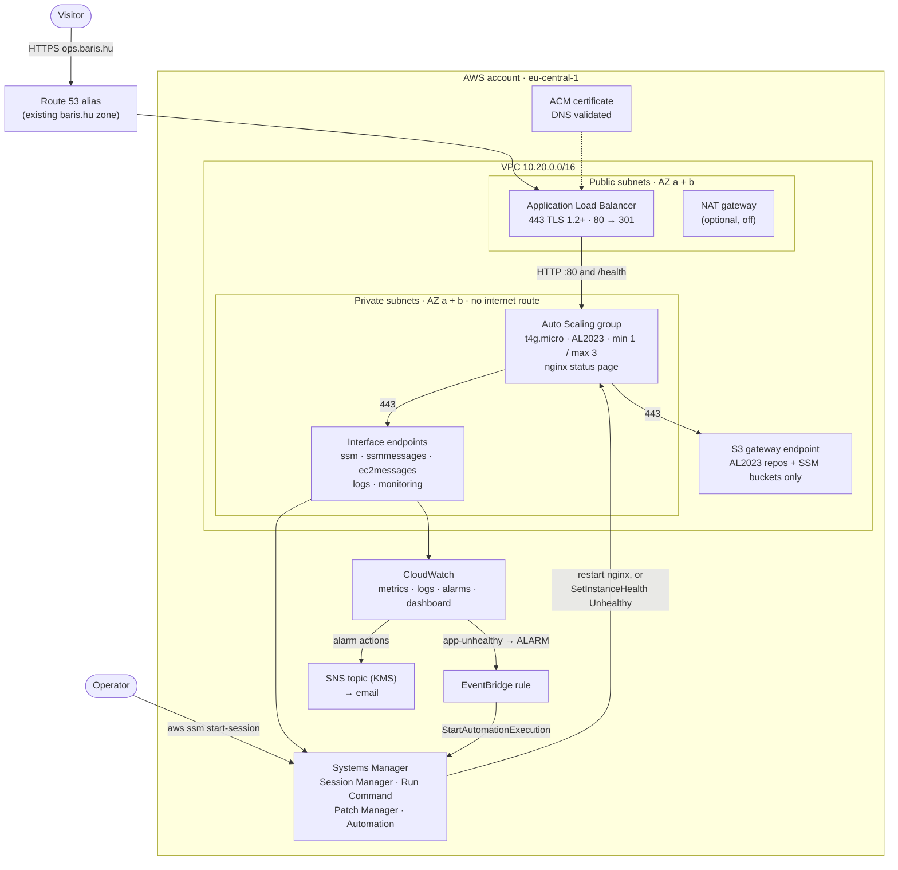
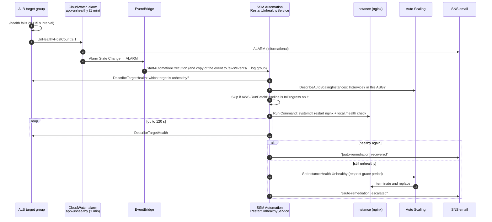

# ops.baris.hu: a private, self-healing web tier on AWS

[](https://github.com/ekincibaris/baris-hu-ops/actions/workflows/terraform.yml)

This is a CloudOps portfolio project, built as production-style Terraform. It serves a small status page at
`https://ops.baris.hu` from an Auto Scaling group of Graviton instances. The instances run in private
subnets that have **no route to the internet**. Nobody can SSH in: all access goes through AWS Systems
Manager. Patching, monitoring and the first response to an outage are automated, and every automated
action is logged.

| | |
|---|---|
| Region | `eu-central-1` (Frankfurt), 2 AZs |
| Entry point | ALB with HTTPS (ACM, DNS-validated) and HTTP→HTTPS redirect, Route 53 alias in the existing `baris.hu` zone |
| Compute | Auto Scaling group with AL2023 on `t4g.micro`, min 1 / max 3, CPU target tracking |
| Access | SSM Session Manager only: no SSH, no key pairs, no bastion |
| Egress | VPC endpoints (SSM ×3, CloudWatch Logs, CloudWatch metrics) and an S3 gateway endpoint. NAT is optional and off by default |
| Patching | SSM Patch Manager: custom baseline, weekly maintenance window, daily compliance scan |
| Observability | CloudWatch agent (memory/disk, nginx logs), dashboard, alarms → SNS email |
| Self-healing | Alarm → EventBridge → SSM Automation restarts the service. If the restart fails, Auto Scaling replaces the instance |
| Quality gates | `terraform fmt`, `validate`, `test` (mocked provider), `tflint`, `checkov` on every PR |

More documentation:
- [docs/DEMO.md](docs/DEMO.md): a 5-minute live demo
- [docs/INCIDENT.md](docs/INCIDENT.md): blameless postmortem of a simulated incident
- [docs/GITHUB-OIDC.md](docs/GITHUB-OIDC.md): the IAM role for running `terraform plan` from GitHub Actions

---

## Contents

1. [Architecture](#architecture)
2. [Repository layout](#repository-layout)
3. [Design decisions and trade-offs](#design-decisions-and-trade-offs)
4. [Auto-remediation](#auto-remediation)
5. [Cost](#cost)
6. [Deploy](#deploy)
7. [Destroy](#destroy)
8. [Runbook](#runbook)
9. [Quality gates and accepted findings](#quality-gates-and-accepted-findings)
10. [Interview talking points](#interview-talking-points)

---

## Architecture



Request path: visitor → Route 53 → ALB (TLS terminates here) → nginx on port 80 in a private subnet.

Operations path: the SSM Agent and the CloudWatch agent on each instance reach AWS only through the
VPC endpoints. `dnf` and Patch Manager download from AWS-owned S3 buckets through the gateway endpoint.

## Repository layout

```
.
├── bootstrap/              # S3 state bucket (+ optional GitHub OIDC plan role). Local state.
├── envs/prod/              # Root module for ops.baris.hu: wiring, KMS key, backend, tests
│   ├── tests/plan.tftest.hcl
│   ├── terraform.tfvars.example   # copy to terraform.tfvars (gitignored)
│   └── backend.hcl.example        # copy to backend.hcl (gitignored)
├── modules/
│   ├── network/            # VPC, subnets, endpoints, optional NAT, flow logs
│   ├── alb/                # ALB, listeners, target group, ACM, Route 53, access-log bucket
│   ├── compute/            # Launch template, ASG, scaling, instance role, CW agent config, Session Manager prefs
│   ├── patching/           # Patch baseline, patch group, maintenance window, scan association
│   ├── monitoring/         # SNS topic, alarms, dashboard
│   └── remediation/        # Trigger alarm, EventBridge rule, SSM Automation runbook, IAM
├── scripts/demo.sh         # Helper for the live demo
├── docs/                   # DEMO.md, INCIDENT.md, GITHUB-OIDC.md
└── .github/workflows/terraform.yml
```

Each module has `versions.tf`, `variables.tf` (typed, described and validated where it makes sense),
`main.tf` and `outputs.tf`. Modules never configure providers. The root configures one provider with
`default_tags`, so every resource gets `Project`, `Environment`, `Service`, `Owner`, `ManagedBy` and
`Repository` tags. Launch templates don't inherit `default_tags`, so the compute module copies the
tags onto instances, volumes and ENIs explicitly.

---

## Design decisions and trade-offs

### VPC endpoints instead of a NAT gateway (security first, but not free)

**Decision.** The private subnets have no `0.0.0.0/0` route. Instances reach AWS through five
interface endpoints (`ssm`, `ssmmessages`, `ec2messages`, `logs`, `monitoring`) and an S3 gateway
endpoint. The S3 endpoint policy only allows `s3:GetObject` on the Amazon Linux 2023 repository
bucket and the buckets that SSM Agent and Patch Manager use.

**Why.**
- **Smaller blast radius.** A compromised instance cannot download tooling from the internet, call a
  command-and-control server or exfiltrate data to an arbitrary host. The only way out is to a short
  list of AWS APIs, and IAM still applies on those.
- **Fewer moving parts to secure.** There are no public IPs on instances, no egress allow-lists to
  maintain and no NAT to patch or monitor.
- **The data path is private.** Traffic to SSM, CloudWatch and S3 never leaves the AWS network.

**The honest cost comparison.** Interface endpoints are billed **per endpoint, per AZ, per hour**.
At this site's traffic level that makes them *more* expensive than a single NAT gateway. Frankfurt
list prices in USD:

| Option | Fixed per month | Data processing | Notes |
|---|---:|---:|---|
| 5 interface endpoints × 2 AZs (default) | 5 × 2 × $0.012 × 730 h = **$87.60** | $0.01/GB | Survives the loss of one AZ |
| 5 interface endpoints × 1 AZ (`single_az_endpoints = true`) | **$43.80** | $0.01/GB, plus cross-AZ data | If that AZ fails, instances lose SSM and CloudWatch |
| 1 NAT gateway + EIP | $37.96 + $3.65 = **$41.61** | $0.052/GB | Single-AZ dependency, full internet egress |
| 2 NAT gateways (one per AZ, the HA pattern) | **$83.22** | $0.052/GB | Full internet egress |

- Endpoints in two AZs cost about **$46 a month more** than one NAT gateway. They only break even at
  around **1.1 TB/month** of traffic, because processing is $0.042/GB cheaper. This status page
  will never get near that.
- Compared like for like with HA NAT (one per AZ), the fixed costs are almost equal, and endpoints
  are cheaper per GB.
- For an interview demo, `single_az_endpoints = true` brings the endpoint bill down to roughly the
  cost of one NAT gateway while keeping the no-internet property.

**Trade-off accepted.** I pay more (or the same) for a smaller attack surface. If the workload ever
needs the internet (third-party APIs, for example), set `enable_nat_gateway = true`. The module then
adds one NAT gateway and opens HTTP/HTTPS egress in the instance security group. Even then, S3
traffic still goes through the restricted gateway endpoint.

### No SSH, no key pairs, no bastion

- The launch template has no `key_name`. No security group allows port 22, and the instance
  security group only accepts traffic from the ALB security group.
- Access goes through **Session Manager**. IAM authorises each session, and the shell travels over
  the `ssmmessages` endpoint, so there are no inbound ports, no keys to rotate or leak, and no
  bastion to patch.
- The `SSM-SessionManagerRunShell` preferences document encrypts every session with the project
  KMS key and **streams the transcript to an encrypted CloudWatch log group**
  (`/ops-baris-prod/ec2/session-manager`). Sessions are therefore audited by default, and CloudTrail
  records who started each one. Idle sessions close after 20 minutes, and every session ends after
  60 minutes.
- Port forwarding (`AWS-StartPortForwardingSession`) covers the "I need to curl the app from my
  laptop" case without opening anything.
- IMDSv2 is enforced, with a hop limit of 1.

### Least-privilege instance role

The instance role does not use `AmazonSSMManagedInstanceCore`. It is a custom policy with the same
agent APIs, minus the account-wide `ssm:GetParameter(s)` on `*`, plus:

- `ssm:GetParameter` on the CloudWatch agent config parameter only
- write access to log groups under `/ops-baris-prod/ec2/*` only
- `cloudwatch:PutMetricData` limited to the `CWAgent` namespace
- `kms:Decrypt` on the project key, which Session Manager encryption needs

The downside is maintenance: if AWS adds an API that a new SSM Agent version needs, I have to add
it myself. `checkov` flags the remaining `Resource: "*"` statements. They are justified inline,
because the agent APIs have no meaningful resource scoping.

### Health check type `EC2` on purpose

The Auto Scaling group uses `health_check_type = "EC2"`, not `"ELB"`. Many tutorials say to use ELB
health checks, so this needs explaining. See [Auto-remediation](#auto-remediation): with ELB health
checks, Auto Scaling would terminate an instance the moment nginx failed, before the restart runbook
could run, and the two automations would race. Application health is handled by the runbook, which
escalates to Auto Scaling itself (`SetInstanceHealth`) when a restart does not help. Instance health
(EC2 status checks) is still handled by Auto Scaling directly.

### Patching: Patch Manager in place, with an immutable fallback

- **Baseline:** Amazon Linux 2023. Security updates rated Critical or Important, plus bug fixes, are
  auto-approved **7 days** after release, so a bad update has time to surface elsewhere first.
- **Patch group via tags:** instances opt in with `PatchGroup=ops-baris-prod-web`. The launch
  template sets the tag, so every new instance is in scope automatically.
- **Maintenance window:** Sundays at 03:00 Europe/Budapest. It runs `AWS-RunPatchBaseline Install`
  with `RebootIfNeeded`, `max_concurrency = 1` and a custom service role that can only send that
  document to instances in the patch group. Output goes to CloudWatch Logs.
- **Daily scan association:** gives compliance data between windows and scans new instances as soon
  as they launch.
- **Immutable path:** the launch template resolves
  `/aws/service/ami-amazon-linux-latest/al2023-ami-kernel-default-arm64` **at launch time**. Any new
  instance (from scale-out, a replacement or `start-instance-refresh`) starts on the newest AL2023
  AMI. In-place patching covers the time between AMI releases and gives the compliance view.
- **Known limitation:** with `min_size = 1`, a patch reboot means 1–2 minutes of downtime. The
  [incident write-up](docs/INCIDENT.md) covers this and the planned fix: scale to 2 before the
  window, or patch with instance refresh only.

### Remote state

- An S3 backend with **`use_lockfile = true`**: S3-native locking through conditional writes, so no
  DynamoDB table is needed. This requires Terraform 1.10 or later.
- The `bootstrap/` folder creates the bucket. It is versioned, encrypted with SSE-KMS (AWS managed
  key), blocks all public access, has a TLS-only bucket policy, expires old versions after 90 days
  and has `prevent_destroy` set.
- Bootstrap itself uses local state (chicken and egg). The file is gitignored; keep a copy, or
  migrate it into the bucket afterwards (see [Deploy](#deploy)).
- The backend uses **partial configuration**: the bucket name lives in a gitignored `backend.hcl`,
  so no account-specific values are committed.

### Version pinning

- Terraform `>= 1.10, < 2.0` in code, because `use_lockfile` needs 1.10. CI pins **1.17.1**.
- AWS provider `~> 6.71` in the roots and `>= 6.0, < 7.0` in the modules. Root
  **`.terraform.lock.hcl` files are committed** with hashes for Linux, macOS and Windows, and CI
  enforces them with `-lockfile=readonly`.
- tflint 0.65.0 with the AWS ruleset 0.50.0, and checkov 3.4.3.
- GitHub Actions are pinned to **commit SHAs**, not tags.

### Things deliberately left out (and what I would add for real production)

| Not included | Why | Production answer |
|---|---|---|
| AWS WAF | About $5 per month plus rule fees, for a static page | Managed rule groups and a rate-based rule on the ALB |
| `min_size = 2` | Cost; it keeps the demo cheap | Two instances, one per AZ, at all times |
| Multi-account | One portfolio account | Separate accounts per environment under AWS Organizations, with SCPs |
| Pager integration | Email only | SNS → PagerDuty/Opsgenie for `no-healthy-hosts` |
| Synthetic monitoring | Cost and scope | A CloudWatch Synthetics canary to measure availability from outside |
| End-to-end TLS | TLS ends at the ALB; the last hop stays inside private subnets | ACM Private CA, or self-signed certificates on the targets, if compliance requires it |

---

## Auto-remediation

**Goal:** when the app stops answering health checks, restart it automatically, log every step and
tell a human what happened. Escalate to a replacement only if the restart does not help.



### Which instance to restart?

The alarm fires on `UnHealthyHostCount` for the **target group**. A target-group metric has no
instance dimension, so the alarm event does not say which instance is broken. The runbook therefore
does not trust the event for that. Its first step asks the source of truth,
`elbv2:DescribeTargetHealth`, and works on **every target currently in state `unhealthy`**. Then it
filters:

1. **It must be a member of this Auto Scaling group** (checked with `DescribeAutoScalingInstances`).
2. **It must be `InService`.** Instances that are `Pending`, `Terminating` or in `Standby` are
   already in Auto Scaling's hands.
3. **It must not be in the middle of patching.** If `AWS-RunPatchBaseline` is `InProgress` on the
   instance, the maintenance window owns it and the reboot is expected.

Alternatives I rejected:
- **One alarm per instance** on a per-instance metric (for example a custom health metric pushed by
  the agent). It works, but alarms would have to be created and deleted as Auto Scaling launches and
  terminates instances: more moving parts and more cost.
- **Restart every instance in the group.** Simple, but it would take healthy capacity away during an
  incident.

### How the runbook and Auto Scaling avoid fighting

There are three automations that react to "target unhealthy": Auto Scaling health checks, this
runbook, and the patch reboot. Each failure type therefore has exactly one owner:

| Failure | Owner | Mechanism |
|---|---|---|
| Instance impaired (EC2 status checks fail) | Auto Scaling | `health_check_type = "EC2"` |
| Application down, instance fine | **Runbook**: restart first | Alarm → EventBridge → SSM Automation |
| Restart does not fix it | Runbook hands over to Auto Scaling | `SetInstanceHealth Unhealthy`, which respects the grace period |
| Expected reboot during patching | Maintenance window | Runbook skips instances with an in-progress patch command |
| New instance still booting | Auto Scaling | Target is `initial`, not `unhealthy`; runbook requires `InService`; health check grace period of 300 s |
| Nothing above worked within 6 min | **Human** | `unhealthy-hosts-sustained` alarm → email |

If the group used ELB health checks, Auto Scaling would mark the instance unhealthy after the same
two failed checks that trigger the alarm. It would then start terminating the instance about a
minute before the runbook could run, turning a 10-second restart into a 3–4 minute replacement.
With `min_size = 1` that is an outage. [docs/INCIDENT.md](docs/INCIDENT.md) walks through exactly
this scenario.

### Everything is logged

| What | Where |
|---|---|
| The alarm event that triggered the run | `/aws/events/ops-baris-prod/remediation-triggers` (second EventBridge target) |
| Each script step's decisions (target states, skips and the reason, polls, escalation), as JSON lines | `/ops-baris-prod/ssm/automation`, through the SSM Automation service setting `customer-script-log-destination = CloudWatch` |
| Restart command output (`systemctl status`, journal, local health check) | `/ops-baris-prod/ec2/run-command` |
| Step-by-step execution history with inputs and outputs | Systems Manager → Automation → Executions |
| Final summary (`recovered`, `escalated` or `no action taken`, with instance IDs) | SNS email |
| API calls (`SendCommand`, `SetInstanceHealth`) | CloudTrail |

Scope and permissions of the runbook role: it may run `AWS-RunShellScript` **only on instances
tagged `AutoRemediationGroup=<this ASG>`**, call `SetInstanceHealth` **only on this ASG**, publish
**only to this topic** and write **only to its log group**. The EventBridge role may start **only
this runbook** and pass **only this role**.

---

## Cost

These are list prices for eu-central-1 in USD, converted at **1 USD ≈ 0.87 EUR**, assuming
negligible traffic and no free tier. Confirm with the [AWS Pricing Calculator](https://calculator.aws/)
before relying on them.

| Item | Calculation | USD / month |
|---|---|---:|
| Interface endpoints (5 × 2 AZs) | 10 × $0.012 × 730 h | 87.60 |
| Application Load Balancer | $0.027 × 730 h + ~0.05 LCU | 20.00 |
| Public IPv4 addresses (ALB, 2 AZs) | 2 × $0.005 × 730 h | 7.30 |
| EC2 t4g.micro (1 instance) | $0.0096 × 730 h | 7.01 |
| EC2 detailed monitoring | 7 metrics × $0.30 | 2.10 |
| EBS gp3 10 GiB | 10 × $0.0952 | 0.95 |
| CloudWatch dashboard | 1 × $3.00 (free if it is one of your first 3) | 3.00 |
| CloudWatch agent custom metrics | ~4 × $0.30 | 1.20 |
| CloudWatch alarms | ~8 metric-alarms × $0.10 (includes the 2 created by target tracking) | 0.80 |
| CloudWatch Logs | <1 GB ingest × $0.63 | 0.50 |
| KMS customer managed key | 1 × $1.00 | 1.00 |
| S3 (state, ALB logs), SNS email, SSM (Session Manager, Run Command, Patch Manager), ACM | free or cents | ~0.10 |
| **Total, default** (`single_az_endpoints = false`) | | **≈ $131.6 ≈ €115 / month** |
| **Total, demo** (`single_az_endpoints = true`) | endpoints $43.80 instead of $87.60 | **≈ $87.8 ≈ €76 / month** |

| Per hour | USD | EUR |
|---|---:|---:|
| Default | ≈ 0.18 | **≈ 0.16** |
| Demo (single-AZ endpoints) | ≈ 0.12 | **≈ 0.10** |
| Each extra instance while scaled out | ≈ 0.013 | ≈ 0.011 |
| `enable_nat_gateway = true` adds | ≈ 0.057 + $0.052/GB | ≈ 0.05 + €0.045/GB |

An interview demo (deploy about 20 minutes beforehand, run the demo, destroy) costs **less than
€1**. Half of the monthly bill is the endpoints; the [trade-off section](#vpc-endpoints-instead-of-a-nat-gateway-security-first-but-not-free)
explains why I accept that. The existing Route 53 hosted zone ($0.50 a month) is not included,
because this project does not create it.

---

## Deploy

### Prerequisites

- Terraform **1.10 or later** (CI uses 1.17.1), AWS CLI v2 and the
  [Session Manager plugin](https://docs.aws.amazon.com/systems-manager/latest/userguide/session-manager-working-with-install-plugin.html)
- Credentials for the target account with administrator rights (for example an SSO profile:
  `export AWS_PROFILE=...`)
- A **public Route 53 hosted zone for `baris.hu` in the same account**, with the domain's
  nameservers delegated to it (ACM validation and the alias record are written there)
- An inbox for alarm emails

### 1. Bootstrap the state bucket (once per account)

```bash
cd bootstrap
cp terraform.tfvars.example terraform.tfvars   # set allowed_account_ids and state_bucket_name
terraform init
terraform apply
terraform output -raw backend_config            # copy this line into envs/prod/backend.hcl
```

The bootstrap state is local (`bootstrap/terraform.tfstate`, gitignored). Back it up, or move it
into the new bucket: add a `backend "s3"` block with a different `key` and run
`terraform init -migrate-state`.

### 2. Configure the environment

```bash
cd ../envs/prod
cp terraform.tfvars.example terraform.tfvars   # account ID, alarm_email, zone, domain, cost switches
cp backend.hcl.example backend.hcl             # paste the bucket line from step 1
terraform init -backend-config=backend.hcl
```

`terraform.tfvars` and `backend.hcl` are gitignored. Only the `*.example` files are committed.

### 3. Plan and apply

```bash
terraform plan -out=tfplan
terraform apply tfplan
```

The first apply takes **about 8–12 minutes**. ACM DNS validation and the interface endpoints are
the slowest parts.

> **If apply fails with `DocumentAlreadyExists: SSM-SessionManagerRunShell`**, someone has already
> saved Session Manager preferences in this account and region. Either import the document:
> `terraform import 'module.compute.aws_ssm_document.session_preferences[0]' SSM-SessionManagerRunShell`
> or set `manage_session_manager_preferences = false`. The SSM Automation log settings are also
> account-wide; set `manage_automation_log_settings = false` if another stack owns them.

### 4. Verify

```bash
# Confirm the SNS subscription email first, otherwise no alarm mail arrives.
curl -sI http://ops.baris.hu | head -3          # 301 to https
curl -s https://ops.baris.hu/health             # ok
terraform output dashboard_url
../../scripts/demo.sh status                    # target healthy, alarms OK
```

Open `https://ops.baris.hu`. The page shows the instance ID and AZ, and refreshes every 5 seconds.

## Destroy

```bash
cd envs/prod
# Only if you turned it on: set enable_alb_deletion_protection = false and apply first.
terraform destroy
```

- This takes about 5–10 minutes. The ALB access-log bucket has `force_destroy = true`, so its
  objects are deleted too.
- The KMS key is scheduled for deletion with a 7-day waiting period. The account-wide Session
  Manager preferences document and the SSM Automation log settings are removed or reset.
- The **state bucket stays** (`prevent_destroy`; it costs cents). To remove it as well, delete the
  `prevent_destroy` lifecycle block in `bootstrap/main.tf`, empty the bucket (including all object
  versions), then run `terraform destroy` in `bootstrap/`.
- Afterwards, check for leftovers:
  `aws resourcegroupstaggingapi get-resources --tag-filters Key=Project,Values=ops-baris --region eu-central-1`.

---

## Runbook

All commands assume `AWS_REGION=eu-central-1`. Names use the default prefix `ops-baris-prod`.

### Connect to an instance (Session Manager)

```bash
# Interactive shell (logged to /ops-baris-prod/ec2/session-manager)
aws ssm start-session --target <instance-id>
# or
scripts/demo.sh shell

# Reach nginx on the instance from your laptop without opening any port
aws ssm start-session --target <instance-id> \
  --document-name AWS-StartPortForwardingSession \
  --parameters 'portNumber=80,localPortNumber=8080'
curl -s localhost:8080/health

# Run a one-off command on every instance and keep the output in CloudWatch Logs
aws ssm send-command --document-name AWS-RunShellScript \
  --targets Key=tag:aws:autoscaling:groupName,Values=ops-baris-prod-web \
  --parameters 'commands=["systemctl is-active nginx","df -h /"]' \
  --cloud-watch-output-config CloudWatchOutputEnabled=true,CloudWatchLogGroupName=/ops-baris-prod/ec2/run-command
```

Useful places on the instance: `/var/log/user-data.log` (bootstrap), `journalctl -u nginx`,
`/var/log/nginx/`, and `/opt/aws/amazon-cloudwatch-agent/logs/amazon-cloudwatch-agent.log`.

### Patching

```bash
# Compliance overview for the patch group
aws ssm describe-instance-patch-states-for-patch-group --patch-group ops-baris-prod-web \
  --query 'InstancePatchStates[].[InstanceId,MissingCount,InstalledPendingRebootCount,FailedCount,OperationEndTime]' --output table

# Scan now (no changes)
aws ssm send-command --document-name AWS-RunPatchBaseline \
  --targets Key=tag:PatchGroup,Values=ops-baris-prod-web --parameters 'Operation=Scan'

# Emergency patch outside the window. With one instance, add capacity first to avoid downtime:
aws autoscaling set-desired-capacity --auto-scaling-group-name ops-baris-prod-web --desired-capacity 2
aws ssm send-command --document-name AWS-RunPatchBaseline \
  --targets Key=tag:PatchGroup,Values=ops-baris-prod-web \
  --parameters 'Operation=Install,RebootOption=RebootIfNeeded' --max-concurrency 1 --max-errors 1 \
  --cloud-watch-output-config CloudWatchOutputEnabled=true,CloudWatchLogGroupName=/ops-baris-prod/ec2/run-command
# Target tracking scales back in after the cooldown.

# Immutable alternative: replace every instance with one on the latest AL2023 AMI (launch before terminate)
aws autoscaling start-instance-refresh --auto-scaling-group-name ops-baris-prod-web

# Last maintenance window runs
aws ssm describe-maintenance-window-executions --window-id "$(terraform -chdir=envs/prod output -raw maintenance_window_id)" --max-results 5
```

To change the schedule, set `patch_schedule` / `patch_timezone`. For the approval delay or
classifications, see `modules/patching/main.tf`.

### Responding to alarms

Every alarm sends to the SNS topic for both ALARM and OK, and every alarm description links to its
section below. The dashboard (`terraform output dashboard_url`) shows all of them on one screen.

#### Alarm: app-unhealthy
*`ops-baris-prod-app-unhealthy`. At least one target failed ALB health checks for 1 minute.*
**This alarm is handled automatically.** It starts the remediation runbook.
1. Wait for the `[auto-remediation] ...` email (normally 1–3 minutes after the alarm).
2. **recovered:** no action is needed. Check the Run Command log for why nginx was down
   (journal output is included), and open a ticket if the cause isn't obvious.
3. **no action taken:** read the `skipped` reason. "patching in progress" is expected on Sunday
   nights. Anything else: continue with *unhealthy-hosts-sustained*.
4. **escalated:** Auto Scaling is replacing the instance. Before it goes, check the Run Command log
   to see why the restart failed (for example `nginx -t` errors).
5. Check the run itself with `scripts/demo.sh executions` or Systems Manager → Automation.

#### Alarm: unhealthy-hosts-sustained
*A target has been unhealthy for 6 minutes: auto-remediation did not fix it.*
1. `scripts/demo.sh status` shows which target and why (`TargetHealth.Reason`).
2. `scripts/demo.sh executions` shows whether the runbook ran. If it did not, check the EventBridge
   rule's metrics (`FailedInvocations`) and the trigger log group.
3. Connect with Session Manager and run `systemctl status nginx`, `nginx -t`, `journalctl -u nginx -n 50`,
   `df -h` and `free -m`.
4. Mitigate first: `aws autoscaling set-instance-health --instance-id <id> --health-status Unhealthy`
   replaces the instance. If every new instance fails too, suspect the AMI or the user data (go to
   *no-healthy-hosts*).
5. Write a postmortem if users were affected ([template](docs/INCIDENT.md)).

#### Alarm: no-healthy-hosts
*Zero healthy targets for 2 minutes. **The site is down.***
1. Is anything running? `scripts/demo.sh status`, then check the ASG activity history for launch
   failures (`aws autoscaling describe-scaling-activities --auto-scaling-group-name ops-baris-prod-web`).
2. Instances are running but unhealthy: read `/var/log/user-data.log`, either in the
   `/ops-baris-prod/ec2/user-data` log group or through Session Manager. Typical causes are `dnf`
   failing (S3 endpoint policy or repository change) or a broken nginx config.
3. What changed recently? Recent `terraform apply`, a new AL2023 AMI (the launch template always
   takes the latest), or a maintenance window run. Roll back by reverting the commit and applying.
   To pin a known-good AMI, set `ami_ssm_parameter` to a versioned parameter.
4. To buy time, increase capacity (`set-desired-capacity`) so healthy instances can join while you
   debug.

#### Alarm: alb-5xx
*5 or more 5xx responses per minute in 2 of the last 3 minutes.*
1. Find out who is returning the errors. On the dashboard, `HTTPCode_ELB_5XX` means the ALB had no
   healthy target or could not reach one (502/503/504). `HTTPCode_Target_5XX` means nginx answered
   with an error.
2. ELB 5xx: check target health (above). 503 usually means there are no healthy targets.
3. Target 5xx: check the `/ops-baris-prod/ec2/nginx/error` log group. ALB access logs (bucket from
   `terraform output alb_access_log_bucket`) have per-request detail. Query them with Athena if needed.
4. Note the time window for the postmortem. Close the alarm only after the dashboard shows 0 for
   10 minutes.

#### Alarm: high-cpu
*Group average CPU ≥ 80% for 8 of 10 minutes, even though target tracking aims for 50%.*
1. Is the group at `max_size`? (`scripts/demo.sh status`) If it is, scaling has hit its ceiling.
2. Is the load real traffic (RequestCount rising) or a runaway process? Check with Session Manager:
   `top -o %CPU`. A leftover `demo-cpu-burn-*` unit is stopped by `scripts/demo.sh unload`.
3. Real traffic: raise `asg_max_size` or move to a larger Graviton type (`instance_type`) through
   Terraform. Don't change it in the console, or Terraform will revert it on the next apply.
4. Runaway process: kill it, then find out why it started (cron job, attack, bad deploy).

---

## Quality gates and accepted findings

Every pull request runs `.github/workflows/terraform.yml`:

| Job | What it checks |
|---|---|
| `terraform fmt` | Formatting across the repository |
| `validate` (matrix: bootstrap, envs/prod, each module) | `init -backend=false` (`-lockfile=readonly` for the roots), then `validate`. In `envs/prod`, it also runs `terraform test`: plan-level tests with a **mocked AWS provider**, so the wiring and variable validation are tested with no credentials |
| `tflint` | `preset = "all"` for the Terraform ruleset plus the AWS ruleset |
| `checkov` | Terraform, GitHub Actions and secrets frameworks |
| `plan` (commented out) | `terraform plan` through GitHub OIDC with a read-only role; see [docs/GITHUB-OIDC.md](docs/GITHUB-OIDC.md) |

Run everything locally:

```bash
terraform fmt -check -recursive
for d in bootstrap envs/prod modules/*; do (cd "$d" && terraform init -backend=false -input=false >/dev/null && terraform validate); done
(cd envs/prod && terraform test)
tflint --init && tflint --recursive
checkov --config-file .checkov.yaml
```

**Accepted checkov findings.** Each one is skipped inline, next to the resource, with its reason:

| Check | Resource | Justification |
|---|---|---|
| CKV_AWS_260 | ALB SG port 80 ingress | Port 80 only returns a 301 redirect to HTTPS |
| CKV_AWS_260 | Instance SG ingress | False positive: the source is the ALB security group, not 0.0.0.0/0 |
| CKV2_AWS_28 | ALB | WAF is out of scope for cost reasons (listed as a production follow-up) |
| CKV_AWS_150 | ALB | Deletion protection is a variable; it is off because the stack is destroyed after each demo |
| CKV_AWS_145 | ALB log bucket | ALB access logs only support SSE-S3 |
| CKV_AWS_18, CKV_AWS_144, CKV2_AWS_62 | ALB log bucket, state bucket | Access logging, replication and event notifications on log/state buckets add cost without value at this scale; versioning is the recovery path |
| CKV2_AWS_34 | CloudWatch agent SSM parameter | The config is not secret |
| CKV_AWS_111, CKV_AWS_356 | Instance role | SSM Agent APIs are not resource-scopable; this matches AWS's own managed policy |
| CKV_AWS_356 | Maintenance window role | List/Get command APIs and tag-based target resolution have no resource-level permissions; `SendCommand` is tag-scoped |
| CKV_AWS_109, CKV_AWS_111, CKV_AWS_356 | KMS key policy | `Resource: "*"` in a key policy means "this key" |

---

## Interview talking points

**1. Your instances have no internet access. How do they get packages and patches?**
The Amazon Linux 2023 repositories are hosted in S3, so an S3 *gateway* endpoint (free) is enough
for `dnf` and Patch Manager. The endpoint policy only allows the AL2023 repository bucket and the
buckets that SSM uses. SSM and CloudWatch traffic goes through interface endpoints with private DNS,
so the agents use their normal hostnames.

**2. Isn't that more expensive than NAT?**
Yes, at this traffic level. Five interface endpoints in two AZs cost about $88 a month, against
about $42 for one NAT gateway, and they only break even at about 1.1 TB a month. Against the HA
setup (one NAT per AZ) the fixed cost is roughly the same. I chose to pay for the smaller attack
surface, and for demos I put the endpoints in one AZ (about $44). If a workload needed third-party
APIs, I would turn the NAT variable on.

**3. How do you get onto a box without SSH?**
With Session Manager. IAM authorises the session, it travels over the `ssmmessages` endpoint, it is
KMS-encrypted, and the whole transcript goes to CloudWatch Logs. There are no keys, no port 22 and
no bastion. For HTTP debugging I use port forwarding.

**4. The alarm is on the target group. How does the runbook know which instance to restart?**
It doesn't trust the alarm for that. Its first step calls `DescribeTargetHealth`, takes the targets
in state `unhealthy`, and keeps only those that are InService members of the ASG and not being
patched. Per-instance alarms would also work, but they would need to be created and deleted as the
ASG scales.

**5. Why `health_check_type = EC2`? Isn't ELB the best practice?**
Normally, yes. Here a runbook restarts the app first, so with ELB health checks the ASG would kill
the instance before the cheap fix could run. I gave each failure type one owner. The runbook owns
app failures and hands over to Auto Scaling with `SetInstanceHealth` if the restart doesn't help.
Auto Scaling owns instance failures. A 6-minute alarm pages a human if both fail.

**6. What happens when Patch Manager reboots an instance?**
The target goes unhealthy and the remediation alarm fires. The runbook sees an in-progress
`AWS-RunPatchBaseline` invocation on that instance and skips it, logging the reason. The window
patches one instance at a time. With only one instance there is still a 1–2 minute blip. The fix is
to scale to two before the window, or to patch only by instance refresh. I wrote this up as a
postmortem.

**7. How does scaling work, and why is detailed monitoring on?**
Target tracking keeps the group's average CPU at 50%. AWS creates and manages the scale-out and
scale-in alarms. Detailed monitoring (1-minute metrics) costs about $2 per instance per month, and
lets scale-out start after about 3 minutes instead of 10–15. `default_instance_warmup` keeps new
instances out of the average until they are ready.

**8. How do you manage Terraform state safely?**
I use an S3 backend with versioning, SSE-KMS, a TLS-only policy and `prevent_destroy`. Locking uses
the S3-native lock file (`use_lockfile`, Terraform 1.10+), so there's no DynamoDB table. The
backend uses partial configuration, so the bucket name isn't in git. `allowed_account_ids` stops an
apply to the wrong account, and lock files with `-lockfile=readonly` stop provider drift.

**9. How do you know the code is secure and correct without an AWS account in CI?**
CI runs fmt, validate, tflint (AWS ruleset), checkov, and `terraform test` with a mocked provider
that exercises the full plan graph and the validation rules. Every checkov exception is written
next to the resource with a reason. Plans against real AWS would use GitHub OIDC with a read-only
role, so there are no long-lived keys.

**10. What would you change for a real production service?**
Run at least two instances, one per AZ. Add WAF. Send `no-healthy-hosts` to a pager. Add a
Synthetics canary for user-facing availability. Use immutable AMIs built by a pipeline (Image
Builder), rolled out by instance refresh with a checkpoint and automatic rollback. Use separate
accounts per environment under Organizations with SCPs. Add AWS Config rules for drift and
compliance. Define an SLO, and alert on error-budget burn instead of raw thresholds.
